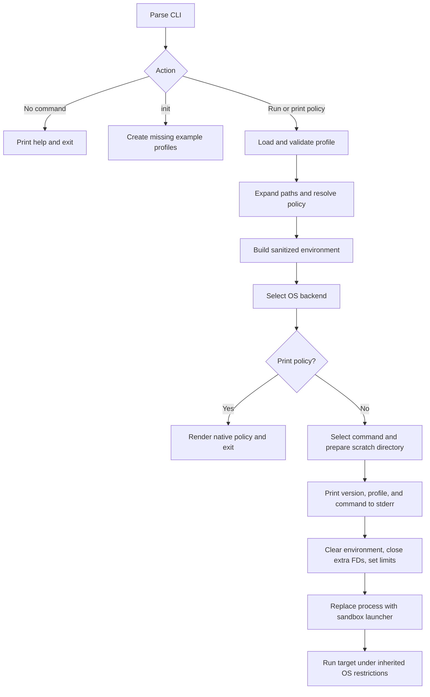

# lilbox design and implementation

lilbox launches an existing agent, program, or interactive shell under an
operating-system sandbox. The implementation is a Rust CLI with macOS Seatbelt
and Linux bubblewrap backends. It does not install agents, modify their permission
settings, or act as a network proxy. Bubblewrap constructs a mount namespace.

This document describes the current implementation. [profiles.md](profiles.md)
is the detailed permissions reference; [README.md](../README.md) provides the
quickstart. See [security.md](security.md) for user-facing security boundaries and
[development.md](development.md) for testing and releases.
[plan.md](../plan.md) records implementation history and verification.
Source links in these documents refer to the repository checkout.

## Goals and boundaries

- Make `lilbox codex`, `lilbox claude`, `lilbox shell`, and
  `lilbox exec <program> [args...]` straightforward to use.
- Provide a permissive default that protects selected credential/private paths,
  while keeping ordinary networking, TLS, and proxy settings usable.
- Offer a closed mode whose filesystem and runtime grants are explicit.
- Preserve command arguments, terminal behavior, signals, and exit status.
- Separate portable policy from OS enforcement so more backends can be added.
- Reject invalid configuration or unavailable enforcement; never retry a failed
  launch outside the sandbox.

Open mode is a deny list, not workspace confinement or comprehensive secret
isolation. Closed mode is only as narrow as its configured grants. In particular,
the working directory is a grant root, not a detected Git repository root.

## Module responsibilities

| Component | Responsibility |
| --- | --- |
| [src/main.rs](../src/main.rs) | Clap CLI, embedded version, profile selection, launch context, command selection, startup display, error reporting. |
| [src/config.rs](../src/config.rs) | Strict TOML schema, recursive inheritance/merge, dependency tracking, atomic initialization. |
| [src/policy.rs](../src/policy.rs) | Portable policy, credential paths, expansion and filesystem alias resolution. |
| [src/check.rs](../src/check.rs) | Read-only discovery, configuration diagnostics, precedence analysis, report output. |
| [src/display.rs](../src/display.rs) | Terminal-safe colors, abbreviated notices, and native policy indentation. |
| [src/inspect.rs](../src/inspect.rs) | Effective profile display with origins and static capability queries. |
| [src/environment.rs](../src/environment.rs) | Child environment filtering, normalization, shell startup flags. |
| [src/backend/mod.rs](../src/backend/mod.rs) | Backend interface and current-platform selection. |
| [src/backend/seatbelt.rs](../src/backend/seatbelt.rs) | Seatbelt rendering and `sandbox-exec` command construction. |
| [src/backend/bubblewrap.rs](../src/backend/bubblewrap.rs) | Linux mount planning, validation, read-only diagnostics, and bubblewrap command construction. |
| [src/backend/bubblewrap/seccomp.rs](../src/backend/bubblewrap/seccomp.rs) | Native-ABI syscall filtering for Linux x86_64/aarch64. |
| [src/backend/runtime.sb](../src/backend/runtime.sb) | Explicit basic runtime capability bundle for closed profiles. |
| [src/launch.rs](../src/launch.rs) | Scratch directory validation, process hardening, Unix process replacement. |
| [profiles/](../profiles/) | Embedded permissive/default/isolated profiles; the agent guide is embedded from docs/. |

The library exposes these modules; the binary coordinates them. `anyhow` carries
contextual errors, Clap parses arguments, Serde/TOML parse configuration, `tempfile`
supports initialization, and `libc` supplies Unix launch operations. `Cargo.lock`
is tracked because lilbox is an application.

## Launch flow

1. With no command, help is printed successfully before
   requiring configuration or a backend. Help and `-v` / `--version` (also `-V`)
   show the package version embedded at compile time from `Cargo.toml`.
2. `HOME` must be present and absolute. The configuration directory comes from
   `--config-dir`, otherwise nonempty absolute `XDG_CONFIG_HOME` plus `/lilbox`,
   otherwise `~/.config/lilbox`. Relative `--config-dir` paths use the launch CWD.
3. `init` creates missing default/permissive/isolated profiles and AGENTS.md, then
   prints the guide path. `--versioned` preserves alternatives; explicit
   `--overwrite-profiles` atomically replaces regular shipped files. `check` (also `profile check`)
   analyzes configurations and exits without executing a sandbox or creating
   scratch storage. Neither command requires an OS execution backend.
4. Normal launches load the selected profile, resolve paths, protect the config
   directory and every inherited profile file, and build the child environment.
5. Backend selection succeeds on macOS and Linux. `policy` prints
   resolved native rules without launching a command or creating scratch storage.
   It uses indentation and terminal-aware color. `profile show` explains access,
   with `--all` and `--origins` for detail. `profile cani` answers static capability
   queries. These validate configuration/environment settings without asking the
   kernel to compile or enforce the rendered policy. Linux snapshots absent deny
   paths out of the effective policy and prints a capped ignored-path notice.
6. A launch selects the command, prepares scratch storage if requested, prints and
   flushes a startup summary to stderr, and invokes the backend command with the
   sanitized environment. The summary shows the embedded version, selected profile
   name, and actual command including shell startup flags. Complex arguments are
   quoted and terminal controls/non-UTF-8 bytes escaped for display only. Color
   requires a stderr terminal, no `NO_COLOR`, and a TERM other than `dumb`.
   Launches also print the customization guide path. Inspection and configuration
   commands have no startup banner.
7. On Unix, `CommandExt::exec` replaces lilbox with
   `/usr/bin/sandbox-exec -p <policy> -- <program> <args...>` or
   `/usr/bin/bwrap <mount/namespace/filter arguments> -- <program> <args...>`.

The policy is an argument, not a persistent generated profile file. The command
and arguments are `OsString`s; no shell command is assembled. Non-UTF-8 command
arguments are preserved. Policy paths must be UTF-8 because they become Seatbelt
source text.

Wrapper options belong before the command. External subcommands support arbitrary
agent/executable names; `exec` also permits names that collide with lilbox commands.
Arguments after the executable belong to it. Pipelines and expansion require an
explicit shell, for example `lilbox exec /bin/sh -c 'echo hello | cat'`.

## Configuration model

Profile files may declare `extends = "NAME"` to inherit one parent. Without this
field they are standalone.
The schema requires `version = 1`. Unknown fields in every configuration table,
unknown enum values, and unsupported versions are errors. Profile names contain
1–64 ASCII letters, digits, underscores, or hyphens; path traversal is rejected.

`default` and `permissive` fall back to their embedded TOML only when absent.
The shipped default inherits permissive; old standalone default files remain
valid. Malformed files and dangling profile symlinks fail. Other names, including
isolated, require files. Ordinary `init` uses temporary files and
`persist_noclobber` to create three profiles and the embedded agent guide without
replacing existing files or symlinks. Versioned initialization uses the same
no-clobber operation for `NAME.toml.VERSION`/`AGENTS.md.VERSION` alternatives.
Explicit overwrite refuses non-regular destinations and uses atomic persist for
regular files. Custom named profiles are never part of this write set.

Updating the executable changes embedded defaults and shared enforcement rules.
Existing active TOML is replaced only with explicit init/installer authorization.

`Mode`, `Network`, and resolved read/write/deny path sets form the portable policy.
`BTreeSet` deduplicates paths and gives deterministic ordering. The environment
is constructed separately as a `BTreeMap<OsString, OsString>`.

### Resolution and merge

`config::load_resolved` returns a `LoadedProfile` containing the effective typed
profile, the dependency names, every source path, and validated raw source
documents in base-to-child order. Origins use the last explicit scalar/map-key
assignment or first introduction of a deduplicated list item. Schema defaults
and built-in filesystem/environment restrictions are labeled separately.
Resolution validates each file with the strict Serde schema, then retains its
TOML value without schema defaults for merging. This avoids mistaking an omitted child boolean
for an explicit `false`, or injecting mode-dependent defaults before the final
mode is known. `version = 1` is mandatory in each file.

A depth-first resolver tracks active names and canonical file targets. Repeated
names/targets are dependency cycles; error contexts show the chain. A 64-profile
limit bounds recursion, including hard-link or otherwise unusual aliases. Invalid
parent names cannot escape the configuration directory through path traversal.
Symlinked files are intentionally supported. Only genuinely absent `default`/`permissive` files
use their embedded fallbacks, including when it is a parent.

Merge tables recursively, append arrays with stable exact-value deduplication,
and replace scalar values with explicit child values. Remove `extends` before
merging. `environment.set` is a table, so individual exact-name child assignments
replace the same parent keys. Empty arrays/tables do not remove inherited entries.
Only then deserialize the merged value into `Profile` to apply schema defaults.
Single inheritance avoids ambiguous precedence between unrelated parents.
`config::parse` remains a standalone-document helper and rejects `extends` without
a configuration directory.

`LoadedProfile::policy` combines portable policy resolution with path protection
for every contributing source file. Both launch and check use this method, so an
inherited parent symlink cannot expose a writable policy file outside the config
directory. On Linux, missing denies are removed after all source protection has
been added; the ignored canonical paths are retained for notices and inspection.
Environment validation is shared between `environment::build` and the checker.

### Static configuration analysis

`check::analyze` discovers local `*.toml` files in sorted order and always includes
`default` and `permissive`, or accepts the explicit `-p` selection. Each selected profile is resolved
independently; an invalid profile does not prevent checking the others. Invalid
filenames, unreadable files, missing dependencies, schema errors, and cycles become
errors. An unresolvable dependency prevents effective-policy checks for that chain.
Within a resolved profile, all configured path entries and environment settings
are validated independently to collect multiple errors. TOML schema errors include
the source path and line. A directory-enumeration failure aborts discovery.

The analyzer compares resolved path aliases with explicit/built-in/configuration
denies. Grants fully shadowed by a deny produce warnings; broader grants with denied
children produce informational exclusions, because those are common intentional
policies. Environment pattern intersections are compared case-insensitively with
the same exact/trailing-star semantics used at launch. It reports ineffective
keeps, dropped assignments, reserved launch variables, suspicious closed-runtime
combinations, broad root/system grants, inaccessible CWD/scratch, and unsafe existing
scratch storage. Intentional child scalar and assignment overrides are not errors.

The checker prints source chains and effective scalar settings, not assignment
values in semantic diagnostics. It does not enumerate or print the parent process's
environment. Terminal controls in report text are escaped. Colors require a terminal,
no `NO_COLOR`, and a TERM other than `dumb`, unless `--color always|never`
overrides the choice; glyphs and severity labels remain in
redirected output. Errors return status 1, warnings return 0 unless `--strict` is
used. CLI argument errors retain Clap's status 2.

On macOS/Linux, check validates native rendering and launcher presence. Linux
also warns about ignored absent denies (three paths plus a remainder count). On other systems,
portable configuration analysis works with an unsupported-execution warning.
It never starts a process or modifies configuration/scratch storage. It cannot
prove kernel enforcement, verify TLS connectivity or certificate contents, or
statically determine all resources an arbitrary executable will need. Relative
paths and aliases are evaluated from the current HOME/CWD, just as at launch.

## Filesystem resolution and precedence

Paths support `~`, `${HOME}`, `${CWD}`, their slash-prefixed descendants, absolute
paths, and launch-directory-relative paths. There is no glob engine, arbitrary
environment expansion, or `~otheruser` lookup. Empty paths, control characters,
non-UTF-8 paths, and `..` components fail. Rejecting `..` avoids changing its
meaning when a preceding component is a symlink.

For each path, the resolver keeps the normalized lexical spelling and its
canonical spelling. For a nonexistent descendant, it canonicalizes the nearest
existing ancestor and appends the remaining components. A dangling symlink or
other resolution error fails rather than weakening the policy. This covers aliases
such as `/tmp` and `/private/tmp`, as well as existing user-created symlinks.

The effective deny set includes the profile's `filesystem.deny`, the built-in
credential list when enabled, the selected configuration directory, and the
selected profile and every ancestor profile's resolved target. Protecting an
individually symlinked
profile prevents modifying its target outside the protected config directory.

On macOS:

- Read grants emit `file-read*` and `file-map-executable` for each subtree.
- Write grants also emit `file-write*`; write access therefore includes reading
  and executable mapping.
- Each grant includes `file-read-metadata` on its ancestors, permitting traversal
  and `getcwd` without granting recursive reads of those ancestors.
- Denies include `file*` plus the explicit read, metadata, write, write-data,
  unlink, executable-map, and ioctl operations used by grants. This is intentional:
  a broad `file*` deny alone can lose to a more specific operation grant.
- Ancestors of denied paths also deny `file-write-unlink`, preventing a parent
  rename/removal from exposing a denied descendant under a new name.

Paths are rendered with Seatbelt string escaping for quotes and backslashes.
Control characters are rejected. Explicit denies win over lilbox's grants;
adding an allow entry is not a way to override credential protection.

Resolution is a launch-time snapshot. It does not eliminate pre-existing hard-link
aliases or races caused by an unsandboxed process changing the filesystem.

## Seatbelt backend and runtime

The backend begins with `(version 1)`, followed by `(allow default)` for open mode
or `(deny default)` for closed mode. It adds the optional basic runtime bundle,
filesystem grants, network rules, and explicit restrictions. There is no raw SBPL
configuration escape hatch.

`runtime.basic` is an explicit capability bundle rather than an automatic
exception to closed mode. It enables execution/fork, same-sandbox signals and
process information, sysctl reads, directory-service lookup, root-directory
reads, selected devices, and terminal/PTY operations. It does not grant all system
libraries, arbitrary Mach services, or the home directory. The exact operations
and paths are listed in [profiles.md](profiles.md#basic-runtime-grants).

The shipped system read grants deliberately use `/System/Library` and
`/System/Cryptexes`, not all of `/System`. `/System/Volumes/Data` provides an alias
to the writable data volume and must not become an accidental broad grant.

### Networking and native trust

`Network::Allow` emits `(allow network*)`; `Network::Deny` emits
`(deny network*)`. There are no endpoint, port, DNS-name, or proxy constraints.
The default permits ordinary HTTPS and WebSockets, and environment inheritance
preserves proxy and CA-bundle settings.

macOS TLS clients may load public roots through SecurityServer/securityd.
Blocking those services caused the system trust-domain query used by
rustls-native-certs to fail and led to `UnknownIssuer` errors. Consequently:

- Online open profiles leave native trust services available through their
  permissive baseline.
- Online closed profiles explicitly grant DNS, trustd, and securityd-related Mach
  lookups. Filesystem and runtime grants still determine which applications and
  additional CA bundles work.
- Offline profiles with credential protection explicitly deny common credential
  service lookups. Closed mode also denies ungranted services by default.

Private-keychain files remain on the filesystem deny list. Permitting the native
services does permit service-mediated keychain operations subject to macOS's own
authorization; it is not a guarantee that no keychain item can be accessed.
lilbox never fixes TLS by disabling certificate verification or replacing roots.

## Linux bubblewrap backend

[The Linux permissions section](profiles.md#linux-bubblewrap-permissions) defines
the platform differences. The backend shares resolved paths and environment rules
with Seatbelt, and uses an absolute `/usr/bin/bwrap` path. Missing launchers or
namespace/filter setup failures never fall back to direct execution.

Open mode binds the host root read/write. Closed mode starts from bubblewrap's
empty root and mounts existing canonical grant roots, preserving lexical symlink
components such as `/lib -> usr/lib`. Write grants dominate read grants. Existing
grant roots and visible deny ancestors are combined in one parent-first mount
order so an ancestor bind cannot undo a child grant or rename pin. Runtime mounts
replace `/proc`, `/dev`, and `/sys`; explicit paths inside those trees are rejected.
Closed mode requires basic runtime and remounts the synthetic root read-only.

Existing denies are applied last as inaccessible read-only empty directories or
files. Nested denies are collapsed. Missing denies are ignored at startup and do
not pin or restrict their parents. The effective Policy records ignored paths for
the startup/check/show notice; files created later during the run may be accessible
under other grants. The mount planner also omits any exclusions absent when mounts
are planned. No host placeholders are created. Check and policy rendering remain
read-only. Missing grants are omitted or use `--bind-try`; launch prepares the
configured scratch directory before planning its mounts.

The backend emits a classic BPF seccomp program for x86_64 or aarch64. Other ABIs
and x32 syscall numbers are rejected. Both modes deny namespace/mount operations,
process-memory/ptrace access, keyrings, BPF, io_uring, open-by-handle, and terminal
injection. Blocking io_uring prevents its socket operations bypassing seccomp.
Namespace flags on clone are blocked; clone3 returns ENOSYS for ordinary clone
fallback. Offline mode adds a network namespace and denies socket/socketpair,
except route-netlink needed by bubblewrap's loopback setup within that namespace.
Online mode keeps the host network namespace and socket access. No CA replacement
or TLS-verification bypass is involved.

Filter and empty-mask payloads are anonymous memory files. Their owning File
objects live through process replacement; only those descriptors are exempt from
inherited-descriptor closing. Each file mask gets its own descriptor because
bubblewrap consumes it. Rendering shows descriptor placeholders and a filter
summary. The launch still passes arguments directly, never through a shell.

## Environment construction

The launcher clears the inherited environment and installs only the constructed
map. Processing is ordered:

1. Validate `keep`/`drop` patterns and `set` assignments. Names use letters,
   underscores, and non-leading digits; patterns optionally end in `*`.
2. Include inherited variables if explicitly kept, or if inheritance is enabled
   and their names are not sensitive. Discard non-UTF-8 names. Comparisons use
   ASCII uppercase, but retained names/values preserve their original spelling.
3. Remove runtime injection variables unconditionally; `keep` cannot restore them,
   and attempting to `set` them is an error.
4. Apply explicit `set` assignments, then case-insensitive `drop` patterns.
5. Normalize mandatory launch context: HOME, PWD, PATH, and `LILBOX=1`. Drop
   relative/empty PATH entries, exact CWD entries, and entries containing `..`.
   A missing PATH gets `/usr/bin:/bin:/usr/sbin:/sbin`; a supplied PATH that becomes
   empty after filtering stays empty.
6. Remove TMPDIR/TMP/TEMP, then set all three to the scratch directory when enabled.
   Remove OLDPWD.

Because normalization follows `drop`, mandatory context variables can reappear
after a drop. `keep` does not synthesize absent variables. `set` can explicitly
provide a sensitive value but should not be used to store secrets in profiles.
Neither environment variables nor executable search paths grant filesystem access.
See [profiles.md](profiles.md#environment-rules) for the exact filter inventory.

### Interactive shells

The shell is selected from the parent's nonempty `SHELL`, otherwise `/bin/zsh` on macOS or `/bin/sh` on Linux,
before environment filtering. Its path must be absolute. Zsh gets `-f -i`, Bash
gets `--noprofile --norc -i`, Fish gets `--no-config -i`, and Sh/Dash/Ksh get `-i`
with environment startup hooks scrubbed. Other shells require explicit `exec`.

These defaults reduce accidental secret reloading from user rc files. System-wide
startup files can still run, and extra shell arguments can change startup behavior.
The wrapper adds no agent-specific bypass flags or nested-sandbox adjustments.

## Process lifecycle and scratch storage

Before entering the sandbox, the launcher creates `~/.cache/lilbox/tmp` when
requested. New directories request mode 0700. An existing final path must be a
directory, not a symlink, owned by the effective user, without group/other
permission bits. Existing permissions are validated rather than silently changed.

Scratch storage is persistent and shared across profiles and invocations for the
same home directory. There is no per-run cleanup supervisor. Explicit denies can
still prevent access to this directory despite the scratch grant.

The single-threaded launcher enumerates `/dev/fd` before its `pre_exec` hook. The
hook performs only system calls: sets umask 077, sets both core-dump limits to zero,
and closes inherited descriptors above 2, except the explicitly owned
bubblewrap filter/mask descriptors. Those are marked inheritable for this exec and
consumed by bubblewrap before it executes the target. Keeping allocation and directory I/O
outside the hook avoids unsafe work in the process-launch callback.

Descriptors 0–2 are preserved. File descriptors opened by the
target after launch are governed by the sandbox. Successful process replacement
leaves no lilbox parent that must forward signals or translate exit codes.
Bubblewrap itself supervises the private PID namespace and target.
It uses `--new-session` to detach the host controlling terminal while preserving
standard-I/O descriptors. Host process groups are not visible in the private PID
namespace; inheriting that session caused interactive dash to fail during exit
cleanup. The new session preserves terminal I/O and shell exit codes, but host
terminal job control and controlling `/dev/tty` access are not promised. macOS
retains its original terminal session.
Configuration/launch errors are printed with a `lilbox:` prefix and exit 1;
subsequent sandbox-launcher/target failures retain their own status.

## Verification and distribution

Portable unit/CLI tests cover parsing, environment precedence, paths and aliases,
temporary-directory validation, initialization, argument forwarding, help, and
version output. The host suite covers actual read/write restrictions, symlinks,
ancestor renames, metadata precedence, TCP/Unix sockets, descendants, descriptors,
exit/signals, and terminal behavior.

The [native trust probe](../tests/fixtures/trust_roots.c) uses the Security and
CoreFoundation frameworks to compare public trust settings inside and outside
the default sandbox without contacting a server. The test reports counts/errors,
not private keys or passwords.

`just check` runs formatting, warning-free Clippy, and portable tests.
`just verify` additionally runs the ignored host suite for the current OS.
macOS needs a host permitting `sandbox-exec`; Linux needs bubblewrap, user
namespaces, seccomp, Python 3, and public CA certificates. Nested sandbox
initialization may be denied. Ordinary `cargo test` does not prove enforcement.

`Cargo.toml` supplies the version. `just package` uses
[scripts/release.sh](../scripts/release.sh) to build a locked release for the native
macOS/Linux target or an explicitly selected supported target (macOS ARM64/x86_64,
Linux ARM64/x86_64 GNU or musl). The target toolchain/linker must be installed;
bubblewrap is a runtime system dependency and is not bundled. It writes a
versioned tarball and SHA-256 sidecar in `dist/`. Archives include the executable,
README, license, changelog, `install.sh`, shipped profiles, the `examples/` gallery, and these docs. Python also writes the SHA-256 sidecar without a platform-specific checksum tool.
File order, ownership, modes, timestamps, and gzip headers are normalized; reproducibility assumes identical
compiled input bytes. Local packaging does not sign, notarize, tag, or publish releases.

`just bump [VERSION]` invokes [scripts/version.py](../scripts/version.py) to
prepare the package/lockfile version, README references, and changelog together.
It defaults to a patch increment and compares numeric stable versions against
the current version, local/remote tags, and GitHub releases, including drafts.
Unavailable remote history blocks preparation and publication. Commit and push
remain manual.

`just release [VERSION]` invokes `scripts/request-release.sh`, a wrapper around
the same helper. A newer optional version prepares edits and stops; the current
version dispatches the GitHub release workflow for a clean, pushed main commit.
The workflow shares source/version validation with the helper and repeats the
history checks immediately before creating a tag. A reusable verification workflow tests
and packages all four native OS/architecture combinations; Linux publication uses
static musl binaries. Ordinary push/PR CI calls that workflow without publication.
The manual release path adds optimized enforcement and publishes only after all
builds and archive checks pass. Its write-scoped final job creates the version tag
at the tested commit and publishes archives/checksums plus `install.sh`.

The POSIX installer detects OS/architecture, resolves latest or a pinned stable
version, verifies the downloaded checksum and embedded version, then atomically
replaces the executable under the requested prefix. It invokes the installed
binary's `init` command with the chosen overwrite/versioned mode and shared
HOME/XDG resolution. Existing shipped profiles and AGENTS.md trigger one prompt
through `/dev/tty` (stdin may carry the script). Declining or no usable terminal
selects versioned alternatives; `--overwrite-profiles` bypasses the prompt. Initialization errors report a partial installation
and a retry command. Progress messages show download, verification, copy, and
initialization stages; successful installs show terminal-aware color, a box logo,
config/executable locations, and usage/PATH guidance. It does not install sandbox
backends. Installer regression tests use the built native executable and temporary
homes to check preservation, replacement, versioned alternatives, and both prompt choices. See [development.md](development.md) for release
and installer requirements.

`just release-installer` invokes `scripts/release-installer.sh` independently of
GitHub binary publication. It stages and syntax-checks the local installer, uses
gcloud to publish a single publicly readable object with a five-minute cache,
and verifies a GCS readback. The public URL is
`https://mo.town/lilbox/install.sh`; the backing object is
`gs://muthanna.com/lilbox/install.sh`. Binary and checksum downloads remain on
GitHub Releases. CI tests this uploader with a stubbed gcloud, without publishing.

CI runs portable checks, enforcement, and packaging on Linux and macOS. The complete contributor commands are in [AGENTS.md](../AGENTS.md).

The separate `www/` landing page is static HTML with embedded CSS/JavaScript and
one generated image. `just upload` runs `scripts/upload.sh`, which validates and
stages the page, publishes fingerprinted assets before the HTML to
`gs://muthanna.com/lilbox/`, and checks the HTML readback. Its public address is
`https://mo.town/lilbox/`. It retains previous assets and leaves the installer
object untouched. No site build or publication is part of binary releases.

## Extending the system

`Backend` exposes `render(&Policy)` and `command(&Policy)` returning fallible
results. Command construction returns `SandboxCommand`, owning a `Command` and
any descriptors needed by the launcher. Seatbelt needs no descriptors; Linux uses
anonymous memory files for its filter and each empty file mask. Add future OS implementations behind this interface and update
platform selection. They must enforce every requested policy feature or reject
the request. A backend must never silently ignore a restriction or launch without
confinement. Process hardening also needs an implementation appropriate to the OS.

Future network/proxy modes belong in the typed configuration and policy, with
backend validation and tests. A managed proxy would additionally require broker
startup, readiness, environment configuration, direct-connection restrictions,
and lifecycle management. The current process-replacement launcher does not
implement that lifecycle. Setting a proxy environment variable alone does not
enforce proxy use.

Keep this document and [profiles.md](profiles.md) synchronized with implementation
changes. Profile behavior comes from code as well as TOML; a renderer or environment
change can alter every installed profile without changing its file.
